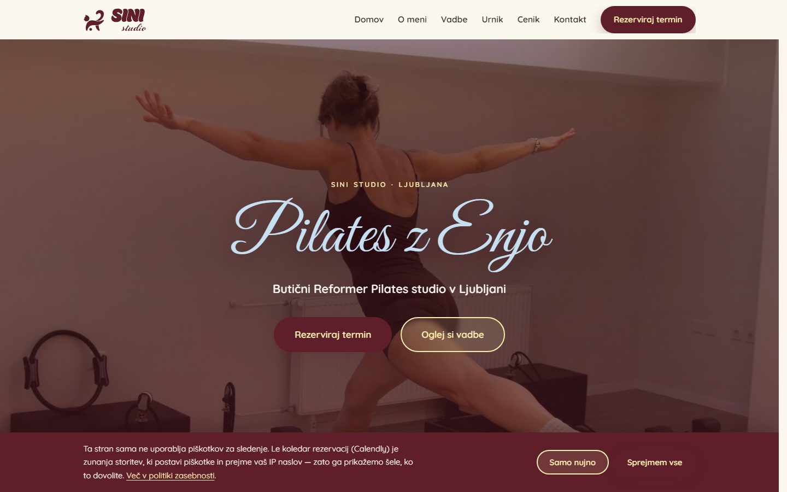

# SINI Studio — website for a boutique Reformer Pilates studio in Ljubljana

**Live:** [sinistudio.si](https://sinistudio.si) · **Status:** in production · **Source code:** private (client work)

A one-page website for a boutique Reformer Pilates studio in Ljubljana, Slovenia. It presents the
trainer, the classes, the schedule and the prices, and lets visitors book a slot. The brand is warm and
personal, so the site had to feel like it — and still load fast and respect visitors' privacy.

  

## What it is

| | |
|---|---|
| **Pages** | One page with seven sections (home, about, classes, gallery, schedule, prices, booking), privacy policy, 404 |
| **Language** | Slovenian |
| **Stack** | Plain HTML, CSS and one JavaScript file — no framework, no build step, no dependencies |
| **Hosting** | Vercel, custom domain |
| **Booking** | Calendly, loaded only after the visitor agrees |

## Highlights

### 1. A deliberate choice: no framework
There is no `package.json` and no `node_modules`. The files in the repository are exactly the files the
visitor receives. For a one-page site this means less to break, nothing to update, and very little to download.

### 2. Privacy first — no cookies, no third-party calls before consent
- The site sets **no cookie** itself.
- The only external service, the Calendly booking widget, loads **only after the visitor clicks to allow it**
  (it brings its own cookies). Before that, nothing is requested from foreign servers.
- Fonts are self-hosted and subsetted (74 KB in total), so the visitor's IP is not sent to Google.
- The map in the footer is a static image from the same server.
- The consent choice is stored in `localStorage` (not a cookie) and can be reset from the footer.

### 3. Brand accuracy
The logo is **vector artwork extracted from the studio's official PDF**, not redrawn. It takes its colour from
the surface it sits on (burgundy on light sections, cream on the burgundy footer).

### 4. Security headers and a Content-Security-Policy
The site sends a Content-Security-Policy and the standard security headers (frame protection, `nosniff`,
referrer policy, HSTS). The hosting platform's config file does not allow comments, so the reasoning behind
each setting is documented in the project notes instead.

### 5. Built to survive failure
Content that fades in on scroll would stay invisible forever if JavaScript failed. Three independent
mechanisms reveal it (an observer, a check on load, and a scroll fallback), so a visitor can never end up
with a blank page — for example after a refresh in the middle of the page.

### 6. Caching without stale images
Photos carry a version in their file name (`foto-01.v2.webp`). Images are cached for 30 days, so replacing a
file under the same name would show the old picture to returning visitors; a new version means a new name.

## Contact
**Darko Ardeljan** · Ulm, Germany · [darko.ardeljan2@gmail.com](mailto:darko.ardeljan2@gmail.com)
